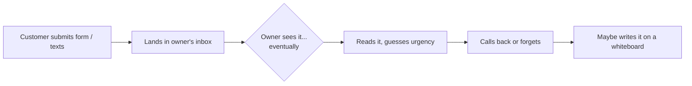
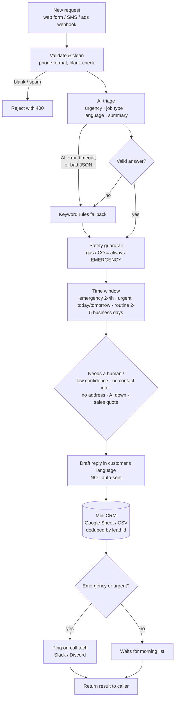

# HVAC Lead Autopilot

**An AI workflow that answers a small HVAC company's service requests in seconds, in English or Spanish, without letting anything dangerous slip through.**

Built by **Gabriel Nadal** (Homestead, FL). Two versions of the same workflow:

| Version | What it is | Where |
|---|---|---|
| **n8n workflow** | Importable, no-code/low-code version (Webhook → OpenAI → Code → Google Sheets → Discord/Slack) | [`n8n/hvac-lead-autopilot.workflow.json`](n8n/hvac-lead-autopilot.workflow.json) |
| **TypeScript script** | Same logic as plain code, runs locally with **zero dependencies** and a built-in mock AI | [`src/`](src/) |

---

## The problem

A one-truck HVAC shop gets requests from its website form, Google ads, Facebook and texts. The owner is on a roof all day, so:

- A **"no AC, baby at home"** message sits next to a **"can I get a tune-up next month?"** one, and they look the same in the inbox.
- A **gas smell** report needs safety instructions *now*, not when someone checks email at 6pm.
- In South Florida, a big part of customers write in **Spanish**.
- Leads get lost: nobody writes them down, double-submitted forms create duplicates, and the tech hears about the emergency last.

Owners spend 10+ hours a week on this kind of admin. This workflow does the first 5 minutes of every lead automatically, and hands anything uncertain to a person.

## Process map

**Before (how it usually works today):**



**After (HVAC Lead Autopilot):**



## How it works

1. **Validate & clean.** Rejects blank/spam submissions, normalizes any phone format to `(305) 555-1234`, and even finds a phone number typed inside the message.
2. **AI triage.** An LLM (OpenAI `gpt-4o-mini`, JSON mode, temperature 0) returns `urgency`, `jobType`, `language`, a 1-line `summary`, `equipment`, `preferredTime` and `confidence`. Prompt: [`src/classify.ts`](src/classify.ts).
3. **Never trust the AI blindly.** Every field is checked against an allowed list. If the call fails, times out or returns junk, a **keyword rules engine** (English + Spanish) takes over and the lead is flagged for review. The rules engine is also the "mock AI" used when no API key is set.
4. **Safety guardrail.** If the message mentions gas or carbon monoxide, it is an emergency and the reply starts with "leave the house and call 911", **no matter what the AI said.** There is a test where the AI is wrong on purpose to prove this.
5. **Time window.** Emergency: 2-4 hours. Urgent (no heat / no AC / leak): this afternoon if before 2pm, else first slot tomorrow. Routine: 2-5 business days, skipping weekends. Calculated from when the lead *arrived*.
6. **Human in the loop.** The lead is flagged for the office when the AI is unsure, there's no way to contact the customer, an urgent job has no address, the AI was down, or it's a sales quote (the owner sets prices).
7. **Reply draft** in the customer's language from fixed templates, so wording to customers is predictable. Drafted, **never auto-sent**.
8. **Mini CRM.** One row per lead in a CSV (script) or Google Sheet (n8n). Logging is **idempotent**: a double-submitted form doesn't create a second row or a second alert.
9. **Tech alert.** Emergencies and urgent jobs ping the on-call tech (Slack/Discord webhook). Routine jobs wait for the morning list. A failed ping is logged and never loses the lead.

## Run it (TypeScript version)

Needs **Node.js 22.18+** (runs `.ts` files directly, no install step, no dependencies).

```bash
npm start          # processes data/sample-leads.json -> output/leads.csv + output/tech-alerts.log
npm test           # 16 tests: script + the n8n Code-node JavaScript
npm run server     # webhook on http://localhost:3000/lead (same as the n8n Webhook node)
```

Optional: `cp .env.example .env`, add `OPENAI_API_KEY`, then `node --env-file=.env src/run.ts`. Without a key it uses the rules engine.

### Sample run (no API key, 8 sample leads)

```
━━ L-1001 | EMERGENCY | no_cooling | es | via rules | CRM: added
   Reply  : Hola Maria, le habla Homestead Comfort HVAC. Recibimos su mensaje y lo tratamos como emergencia...
━━ L-1002 | EMERGENCY | gas_or_co_safety | en | via rules | CRM: added
   Reply  : Hi James, ... please leave the house now and call 911 or your gas company from outside...
━━ L-1004 | URGENT | water_leak | es | via rules | CRM: added
   Review : no address for a dispatch
━━ L-1006 | ROUTINE | other | en | via rules | CRM: added
   Review : low AI confidence; no way to contact customer
━━ L-1001 | ... | CRM: duplicate — skipped, no 2nd alert
✖ L-1007 skipped: Lead is missing a message

Done: 7 processed, 3 flagged for office review, 1 rejected.
```

The sample data includes the bad-day cases on purpose: a Spanish message, a gas leak, a missing address, a vague message with no contact info, a double-submitted form, and a blank spam submission.

## Files

```
src/
  types.ts      data shapes (Lead, Triage, ProcessedLead)
  pipeline.ts   the whole workflow in one function — start here
  classify.ts   AI call + validation + fallback + safety guardrail
  rules.ts      bilingual keyword engine (mock AI / fallback)
  schedule.ts   time windows (business days)
  reply.ts      English/Spanish reply templates
  crm.ts        CSV mini CRM, deduped by lead id
  notify.ts     tech alert log + Slack/Discord webhook
  run.ts        CLI runner      server.ts   local webhook
n8n/
  hvac-lead-autopilot.workflow.json   import this into n8n
  code/*.js                           the JavaScript inside the 3 Code nodes
  build-workflow.mjs                  regenerates the JSON from code/*.js
test/           16 tests (node:test)
data/sample-leads.json
SETUP.md        step-by-step n8n import + demo recording
TALKING_POINTS.md
```

## What I'd add next

- **Real FSM integration:** create the job in Housecall Pro / Jobber / ServiceTitan through their APIs instead of a sheet, and pull real open slots for the time window.
- **Approve-to-send:** office manager taps "Approve" in Slack, then the reply goes out by SMS (Twilio) or email.
- **Per-company config:** business hours, service area ZIPs, after-hours emergency fee and which job types each shop takes, in one config file, so the same workflow serves many contractors.
- **Accuracy tracking:** log when the office changes the AI's urgency, and use those corrections as test cases to improve the prompt.
- **Rebate helper:** for heat pump quotes, attach the federal/utility rebates the customer may qualify for.
